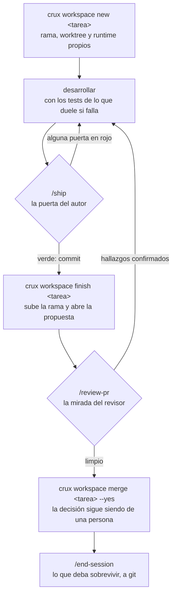

# crux

El *crux* es el paso clave de una vía: el punto del que depende todo lo demás.

Este repo es el **kernel del sistema de trabajo con agentes**. Contiene el
estándar de documentación, las skills transversales, las plantillas y el
tooling que usan todos los proyectos. Se instala una vez por máquina y desde
él se lanzan y se mantienen los repos de documentación de cada proyecto.

No es un repo de documentación de un proyecto. Es lo que los fabrica.

---

## Instalación

```bash
git clone git@github.com:jocarrd/crux.git ~/Proyectos/crux
~/Proyectos/crux/install.sh
```

Eso deja las skills disponibles en Claude Code (`/<nombre>`) y en Codex
(`/<nombre>`), y registra en `~/.crux/config` dónde vive el kernel y cuál es la
raíz de proyectos.

**Dónde clones el kernel decide dónde viven tus proyectos**: si lo pones en
`/opt/dev/crux`, la raíz es `/opt/dev`. Se cambia con
`install.sh --projects-dir <ruta>`.

## El ciclo de trabajo

Una tarea de desarrollo entra por un espacio aislado y sale como propuesta
revisada. Ese es el recorrido completo, y **`/flow` es la entrada por defecto**:
encadena las skills en este orden y explica por qué es ese y no otro.



Las dos preguntas del centro son distintas, y por eso son dos pasos:

- **`/ship`** pregunta *¿está listo lo que hice?* — tests, diff leído,
  correctitud, regresión. La pasa quien escribió el cambio, antes de commitear.
- **`/review-pr`** pregunta *¿es correcto y completo lo que se propone?* —
  desde un contexto independiente. Quien acaba de defender cada decisión no
  está en posición de refutarlas, y el hueco típico —arreglar un problema por
  la puerta por la que se encontró y dejarlo abierto por otra— solo se ve desde
  fuera.

### Qué lo sostiene cuando nadie se acuerda

Un ciclo que depende de la memoria no es un ciclo. Estas guardas lo hacen
cumplir, y las instala `crux hooks install`:

| Guarda | Qué impide |
| ------ | ---------- |
| `pre-push` en la rama principal | Empujar a `main` sin pasar por propuesta |
| `commit-msg` | Mensajes de commit fuera del idioma del estándar |
| `.crux-ship` | Abrir propuesta de un commit que no ha pasado `/ship` |
| `crux doctor` en el cierre | Cerrar sesión con el proyecto fuera del estándar |

## Comandos

| Comando | Qué hace |
| ------- | -------- |
| `crux init <project>` | Crea `~/Proyectos/<project>/<project>-docs` desde las plantillas |
| `crux clone <project>` | Trae un proyecto entero a una máquina nueva |
| `crux adopt` | Registra un docs repo que ya existe bajo el estándar |
| `crux add-repo <repo>` | Registra un repo nuevo en un proyecto adoptado |
| `crux link` | Crea y verifica los punteros de los repos de código del proyecto |
| `crux workspace` | Espacios aislados —worktree, puertos, base de datos—, con propuesta y fusión |
| `crux review` | Reúne el material para revisar una propuesta: commits, diff, checks y señales |
| `crux doctor` | Verifica la conformidad de un docs repo con el estándar |
| `crux doctor --machine` | Verifica que la máquina tiene lo que las skills necesitan |
| `crux hooks` | Engancha el estándar al ciclo, al cierre de sesión y al commit |
| `crux usage` | Qué skills se usan de verdad |
| `crux upgrade` | Re-materializa el kernel en un proyecto a la versión actual |
| `crux release <ver>` | Publica una versión, verificando antes que los proyectos siguen conformes |

Todos existen también como skills: `/crux-init`, `/crux-doctor`, etc.

Guía completa, de lo sencillo a lo profundo: `GUIA.md`.
Si vas a trabajar **en este repo**, empieza por `AGENTS.md`.

## Las tres capas

| Capa | Qué es | Dónde vive |
| ---- | ------ | ---------- |
| **Kernel** | Estándar, skills transversales, plantillas, tooling | este repo |
| **Proyecto** | Documentación del proyecto y sus skills propias | `<project>-docs/` |
| **Repo** | Punteros de contexto, generados | cada repo de código |

Cada docs repo declara su contrato con el kernel en un `crux.json`:

```json
{
  "crux": "0.7.0",
  "project": "acme",
  "profile": "multi-repo",
  "repos": ["Acme", "acme-engine", "acme-cms"],
  "sections": ["architecture", "conventions", "operations", "topics"]
}
```

## Agentes soportados

El conocimiento se escribe **una vez en markdown neutro**. El instalador lo
materializa para cada agente:

| Pieza | Claude Code | Codex |
| ----- | ----------- | ----- |
| Skill | symlink en `~/.claude/skills/` | stub en `~/.codex/prompts/` |
| Contexto global | `~/.claude/CLAUDE.md` | `~/.codex/AGENTS.md` |
| Contexto de proyecto | `CLAUDE.md` (symlink) | `AGENTS.md` (canónico) |
| Puntero de repo | `CLAUDE.md` con `@-import` | `AGENTS.md` con ruta |

Por eso ninguna skill del kernel menciona herramientas propias de un agente
concreto: describe la acción, no quién la ejecuta.

## Estructura

```
crux/
├── AGENTS.md        contexto para trabajar en el kernel (CLAUDE.md → symlink)
├── STANDARD.md      el estándar completo — léelo si vas a tocar algo
├── GUIA.md          cómo funciona todo, de principio a fin
├── VERSION
├── install.sh       una vez por máquina
├── bin/             init, clone, adopt, add-repo, link, workspace, hooks, usage, doctor, upgrade
├── lib/             verificadores de paths y utilidades comunes
├── templates/       docs-repo/ y code-repo/
├── profiles/        multi-repo, client-repo
├── adapters/        claude/, codex/
├── skills/          las skills transversales
└── test/            suite del propio kernel
```

El catálogo completo de skills, en `STANDARD.md`.

## Tests

```bash
./test/run.sh            # todos los casos
./test/run.sh doctor     # solo los que casan con el patrón
```

Cada caso corre en un sandbox aislado con los directorios de agentes
redirigidos: la suite no toca `~/.claude`, `~/.codex` ni `~/Proyectos`.

Dos de los casos vigilan el propio kernel: que ninguna skill se ate a un agente
concreto y que no aparezca el nombre de ningún proyecto. Son los que evitan que
crux vuelva a acoplarse a lo que documenta.

## Gobernanza

- **CI** en cada push y propuesta: análisis estático, la suite, instalación en
  limpio y un proyecto creado de principio a fin.
- **`crux hooks install`** cierra la rama principal: el trabajo entra por
  propuesta. Y recuerda el ciclo al empezar sobre ella, porque medimos que
  describirlo en una skill no bastaba.
- **`crux release <ver>`** publica una versión, y antes **verifica que los
  proyectos que consumen el kernel siguen conformes**. Es lo que lo distingue
  de un `git tag`: cambiar el estándar y romper a quien lo usa sin enterarse es
  el fallo que un release debe impedir.

El número de versión se sube en `VERSION` por propuesta, como cualquier otro
cambio. El comando solo etiqueta.

## Estado

La versión la declara `VERSION`; cada docs repo declara en su `crux.json` con
cuál se materializó, y `crux doctor` avisa cuando se separan.

Proyectos que lo consumen: `acme-docs`, `client-docs`.
