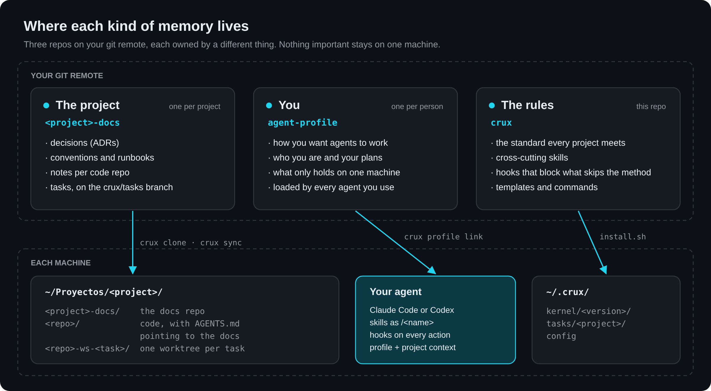
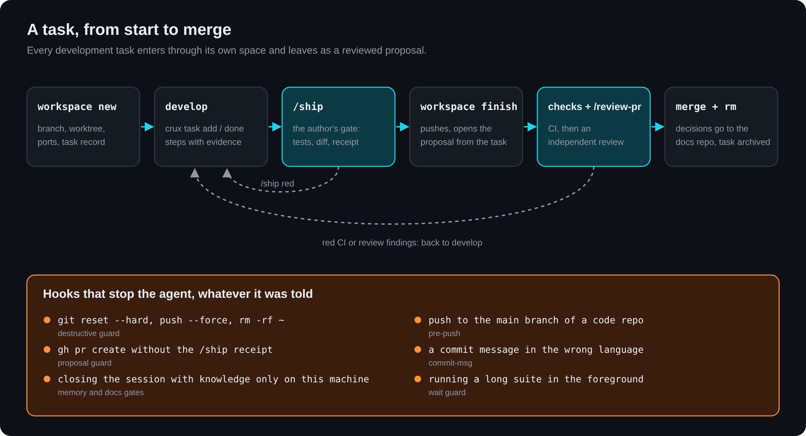
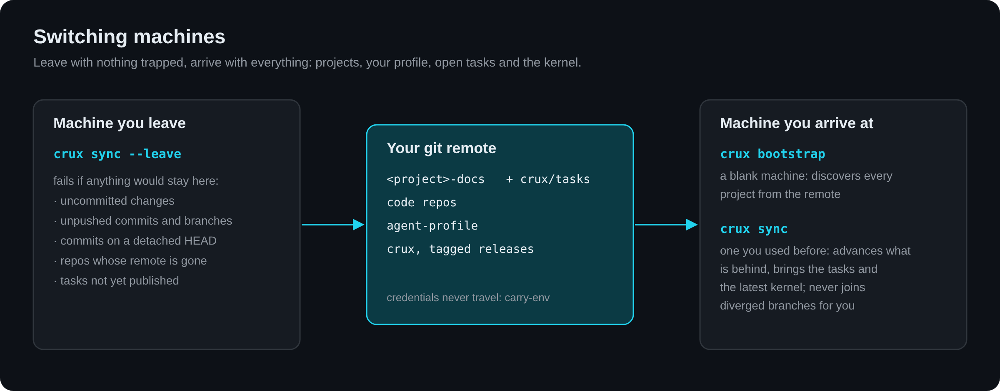

<p align="center">
  
</p>

# crux

**A kernel for working with coding agents across many projects.** It decides
where each kind of knowledge lives, which steps a task follows from start to
merge, and what has to be checked before anything is called done. The agent
works inside that frame and cannot step out of it on its own.

The *crux* is the key move of a climbing route: the point on which everything
else depends.

It works with Claude Code and Codex. It is one binary that only needs `git` to
run, and it installs once per machine.

---

## Why it exists

Working with agents on several projects at once, the same four problems kept
coming back:

- **They forgot.** What you explained in one session was gone in the next, and
  everything learned on the laptop was missing on the desktop: measured before
  switching computers, 55 memories on one machine and none on the other.
- **They skipped the rules.** Commits in English, tests before pushing, one
  task per branch: written in each repo's `CLAUDE.md`, and skipped anyway,
  because nothing stopped it.
- **Parallel work collided.** Two sessions on the same repo mixed their changes
  into one commit; two dev servers fought over the same port and database.
- **"Done" was not verified.** Tests passed, nobody had looked at the screen,
  and the agent wrote in the commit that it was checked.

crux answers each one with something that does not depend on anyone
remembering: a place in git for every kind of memory, an isolated space per
task, quality gates that leave a receipt, and hooks that block what skips the
method.

## How it works

<p align="center"></p>

Knowledge is split by **who it belongs to**, and each kind gets its own git
repo:

- **The project** — `<project>-docs`, one per project, next to its code repos.
  Decisions as ADRs, conventions, runbooks, notes per repo, and the tasks in
  progress on a `crux/tasks` branch that `main` never sees. Each code repo gets
  a small generated `AGENTS.md` / `CLAUDE.md` that points the agent here.
- **You** — `agent-profile`, one per person. How you want agents to work, who
  you are, what only holds on one machine. Every agent you use loads it, so
  your preferences follow you across machines and across agents.
- **The rules** — this repo. The standard every project meets, the
  cross-cutting skills and the hooks. Installed once per machine as a fixed
  version, so tinkering with it never changes how your projects behave.

Everything is plain markdown in git: versioned, on your own remote, readable by
you and by any agent, and nothing extra to pay for or maintain.

### The words used below

| Term | What it is |
| ---- | ---------- |
| **Kernel** | This repo, installed on each machine. It holds no project's knowledge, only the rules and the tooling |
| **Docs repo** | `<project>-docs`: a git repo holding only a project's documentation, as a sibling of its code repos |
| **Contract** | The `crux.json` in a docs repo: the project's name, its code repos, its remote and the kernel version it follows |
| **Profile** | A policy a project declares: `multi-repo` for your own code, `client-repo` when the code is someone else's |
| **Pointer** | A short, generated `AGENTS.md` / `CLAUDE.md` in each code repo that sends the agent to the docs repo |
| **Person's profile** | `agent-profile`: your preferences and context, loaded by every agent on every machine |
| **Skill** | A procedure in markdown (`skills/<name>/SKILL.md`) the agent follows when invoked as `/<name>` |
| **Hook** | A script the agent or git runs on its own before or after an action; the ones here block or remind |
| **Workspace** | An isolated space for one task: branch, git worktree, ports and database of its own |
| **Task record** | The file where a task keeps its goal, plan, steps with evidence, next step and decisions |
| **Gate** | `/ship`: the checks a change passes before it is committed |
| **Receipt** | What the gate leaves behind: which checks ran, on which commit, with what result. Opening a proposal requires it |
| **Proposal** | A pull request (or merge request), opened by `crux workspace finish` |
| **Adapter** | How the kernel is exposed to one agent or tool: `claude/`, `codex/`, `git/` |

### What a session looks like

1. **You open the agent in a project.** A hook brings the machine up to date
   with your remote and lists the open tasks, without pushing you to resume
   any. The agent has already loaded your profile and the project's index.
2. **You ask for something.** If it is a development task, the agent opens a
   workspace for it; if you are on the main branch, a hook reminds it once.
   It reads the project's conventions, in the docs repo, before writing code.
3. **It works and records.** Each step goes into the task record with what
   proves it. A decision with a reason is noted as one. If it tries something
   destructive, or runs the whole suite in the foreground, a hook stops it.
4. **It passes the gate.** `/ship` runs the tests the diff touches, reads the
   whole diff, checks the project's conventions, runs the whole suite and
   leaves a receipt.
5. **It proposes.** `crux workspace finish` pushes the branch and opens the
   proposal with a description taken from the task record. Then the CI, and an
   independent review.
6. **You merge.** The space is closed, the task archived, and its decisions are
   committed to the docs repo, where the next session will find them.
7. **You close the session.** If the session learned something that only lives
   in the conversation or in the agent's local memory, a gate asks where it
   goes before letting it end.

Tomorrow, on another machine, `crux sync` brings all of it back.

## Quick start

```bash
# once per machine (it builds crux with Rust's cargo: https://rustup.rs)
git clone https://github.com/jocarrd/crux.git ~/Proyectos/crux
~/Proyectos/crux/install.sh

# then let it walk you through the rest: account, remote, profile, projects
crux setup

# a new project: creates <project>-docs on your remote, from the templates
crux init shop --repos shop-web,shop-api

# your profile: a private repo that every agent loads
crux profile init

# a task
crux workspace new checkout-flow --goal "Pay with a saved card"
#   ...work; then, inside the agent:  /ship
crux workspace finish checkout-flow   # pushes the branch, opens the proposal

# a machine with nothing on it
crux bootstrap
```

The binary carries the whole kernel, so with the binary alone `crux install`
does the same as `install.sh`. Where you clone the kernel decides where
projects live: the root is the clone's parent directory (`~/Proyectos` above). `crux doctor --machine` tells
you whether the machine is missing anything the skills need.

## A task, from start to merge

<p align="center"></p>

`/flow` is the default entry point for any development task: it chains the
steps in this order and explains why.

**Each task gets its own space.** `crux workspace new` creates a branch, a git
worktree, its own ports and database name, and a task record. Several tasks on
the same repo run in parallel without touching each other's files.

**The task record is how work is resumed without rebuilding it.** It lives in
`~/.crux/tasks/<project>/<task>.md`: goal, scope, plan, steps with their
evidence, next step and decisions. The commands write it; you do not edit it by
hand.

```bash
crux task add "card registration" "payment" "receipt email"
crux task done T1 "green e2e test, screenshot of the dialog"
crux task note "Receipts still go by email" --why "the provider has no webhook for it"
crux task next "try the payment in Safari"
crux task                              # state, steps and next step
```

A note with `--why` is a **decision**: when the task is archived, crux moves it
to `repos/<repo>/notes.md` in the docs repo and commits it, because the next
session will not read a closed task.

| Moment | What happens to the record | State |
| ------ | -------------------------- | ----- |
| `crux workspace new` | It is created; `--task` adds another repo to the same task | `open` |
| `crux task plan <file>` | The approved plan is written down | `planned` |
| `crux task done` | The step is marked with what proves it | `in-progress` |
| `crux ship seal` | The gate's receipt is recorded as evidence | `verified` |
| `crux workspace finish` | The proposal's description comes from here | `proposed` |
| `crux merge` | The merge is noted | `merged` |
| `crux workspace rm` | Archived in `done/`; decisions go to the docs repo | `closed` |

When you are waiting on someone else, the task **waits** without holding a
space:

```bash
crux task wait --on "the client" --ask "shall we point the domain at the new server?"
```

It notes who, what and since when, removes the space and the branch if they
hold nothing of their own, and reminds you to follow up after a week.
`crux workspace resume` picks it up again.

**Two reviews, two questions.** `/ship` is the author's gate before committing:
tests, the whole diff read, correctness, regression, and a receipt of what ran.
`crux workspace finish` refuses to open a proposal without it. `/review-pr`
comes after, from an independent context, and asks whether what is proposed is
correct and complete: whoever has just defended each decision is in no position
to refute it.

## Switching machines

<p align="center"></p>

```bash
crux sync --leave        # leaving: fails if anything would stay only here
crux bootstrap           # a blank machine: discovers every project and brings it
crux sync                # a machine you used before: brings it up to date
```

**`--leave`** lists what would not reach the other machine: uncommitted
changes, unpushed commits, branches on no remote, commits on a detached HEAD,
repos whose remote no longer exists and tasks not yet published. Stashes show
up as a warning, because they do not travel.

**`bootstrap`** verifies the machine first, then asks your remote which
projects exist —the `*-docs` repos that carry a `crux.json`— and brings each
one with its code repos, pointers, hooks and the tasks left open on your other
machines. The list comes from the remote,
not from a file you would have to keep up to date.

**`sync`** walks what is already on disk, fetches and fast-forwards every clean
branch that is behind, brings the tasks from the other machine, clones repos a
project gained elsewhere, and installs the latest published kernel. It names a
repo whose `origin` no longer matches the contract, for instance after moving
it to an organization. It never touches a branch with uncommitted changes or
one that diverged: joining them is a decision, and a script does not make it.
A session-start hook runs it at most once every ten minutes and only speaks if
something changed.

**What does not travel:** credentials. SSH keys, tokens and `.env` files are
not copied by a tool; the `carry-env` skill moves them deliberately, and
`bootstrap` ends by saying what each project needs.

## What holds it up when nobody remembers

A rule written in a file is advice. These are installed by
`crux hooks install` and act whether or not anyone remembers them:

| Guard | What it does |
| ----- | ------------ |
| Destructive guard | Stops `git reset --hard`, `push --force`, `clean -fd`, discarding the tree, `rm -r` on `/`, `~`, `.` or `*`, `pkill`/`killall`, and reading private keys. A person who really wants it runs it themselves |
| `pre-push` | Pushing to the main branch of a code repo without a proposal |
| `commit-msg` | Commit messages outside the project's language, and tool signatures in them |
| Proposal guard | Opening a proposal by hand, skipping the receipt `finish` demands |
| Wait guard | Running a long suite, a build or a CI watch in the foreground while other work waits |
| Worktree guard | Deleting a registered space by hand and leaving the registry lying |
| Cycle reminder | Starting to work on the main branch of a managed repo, once per session |
| Task context | Resuming a space without knowing where its task was left |
| Session sync | Opening a session on a machine that is behind the remote |
| Documentation gate | Closing a session whose findings never reached the docs repo |
| Memory gate | Closing a session with project knowledge only in the agent's local memory |
| Profile reminder | Losing the person's own standing reminder in a long session |

## Commands

| Command | What it does |
| ------- | ------------ |
| `crux init <project>` | Creates `<project>-docs` from the templates, on your remote |
| `crux clone <project>` | Brings a whole project onto this machine |
| `crux setup` | Gets this machine ready step by step, asking only what it cannot work out |
| `crux bootstrap` | Gets a blank machine ready: verifies, discovers every project and brings it |
| `crux install` | Lays out the kernel the binary carries: with the binary alone, a machine needs nothing else |
| `crux adopt` | Puts an existing docs repo under the standard |
| `crux add-repo <repo>` | Registers a new code repo in a project |
| `crux archive <repo>` / `unarchive` | Retires a repo from production while keeping it, or brings it back |
| `crux link` | Creates and verifies the pointers in the code repos |
| `crux workspace` | Isolated spaces with worktree, ports and database; `finish`, `resume`, `rm`, `gc` |
| `crux task` | The task record: steps with evidence, next step, decisions, waiting |
| `crux ship` | The quality gate: runs the checks and leaves a receipt |
| `crux visual` | Records the approved before/after of a visual change for the proposal |
| `crux review` | Gathers what a review needs: commits, diff, checks, risk, specialists |
| `crux checks [n]` | Waits for a proposal's CI and brings only the end of what fails |
| `crux merge <n>` | Merges a proposal after saying which one and in which repository |
| `crux doctor` | Checks a docs repo against the standard; `--machine` checks the machine |
| `crux hooks` | Installs the guards into the agent and into git; `crux hooks add` gives a repo git hooks of its own, run after crux's |
| `crux mcp` | Writes the MCP servers a project declares and checks they respond |
| `crux stg` | Publishes a built folder to a keyed staging |
| `crux usage` | Which skills are actually used |
| `crux skill test <skill>` | Runs a skill's scenarios and flags what changed against another version |
| `crux memory` | Agent memories still only local, and where each one belongs |
| `crux profile` | The person's profile repo: `init`, `link`, `clone` |
| `crux status` | What is open right now across all projects |
| `crux sync` | Up to date on arrival; `--leave` checks nothing stays trapped |
| `crux upgrade` | Re-materializes a project at the current kernel version |
| `crux release <ver>` | Publishes a kernel version, first checking that projects stay conformant |

Every command accepts `--help`. The complete guide, from simple to deep, is
[`GUIA.md`](GUIA.md); the full standard is [`STANDARD.md`](STANDARD.md).

## Skills

45 cross-cutting procedures in plain markdown (`skills/<name>/SKILL.md`), each
invoked as `/<name>`: the cycle (`flow`, `workspace`, `ship`, `review-pr`,
`end-session`), debugging and testing (`root-cause`, `write-tests`, `e2e`,
`bug-hunt`), interfaces (`visual-test`, `before-after`, `ui-tells`),
documentation (`adr`, `promote-to-docs`, `runbook`) and more. A project adds
its own in its docs repo; when one of its skills turns out to be a general
pattern, it moves here and the project keeps a thin adapter with its own data.

## The contract

Each docs repo declares in a `crux.json` what it is and which kernel it
follows:

```json
{
  "crux": "0.69.0",
  "project": "shop",
  "profile": "multi-repo",
  "language": "en",
  "branch": "main",
  "repos": ["shop-web", "shop-api"],
  "remote": { "url": "git@github.com:you/{repo}.git", "visibility": "private" }
}
```

`crux doctor` checks the docs repo against it and warns when the declared
version falls behind the installed one. A **profile** sets policy:
`multi-repo` for your own projects, `client-repo` when the code belongs to a
client and nothing of yours may be written into it. A project can override
single fields with a `profile.json` in its docs repo.

## Supported agents

Knowledge is written once, in neutral markdown, and the installer exposes it to
each agent:

| Piece | Claude Code | Codex |
| ----- | ----------- | ----- |
| Skill | symlink in `~/.claude/skills/` | prompt in `~/.codex/prompts/` |
| Your profile | imported from `~/.claude/CLAUDE.md` | `~/.codex/AGENTS.md` |
| Project context | `CLAUDE.md` | `AGENTS.md` |
| Repo pointer | `CLAUDE.md` with `@-import` | `AGENTS.md` with a path |

That is why no skill names the tools of a specific agent: it describes the
action, not who runs it.

## Installation in detail

### What it leaves installed

| What | Where | What for |
| ---- | ----- | -------- |
| The kernel version | `~/.crux/kernel/<version>/` | The copy your projects run, with its binary in `bin/crux-core` |
| The command | `~/.local/bin/crux` | `crux` from any directory |
| The skills | `~/.claude/skills/`, `~/.codex/prompts/` | `/<name>` in the agent |
| Machine config | `~/.crux/config` | Where the kernel and the projects live, and your preferences |

Make sure `~/.local/bin` is in your `PATH`.

### Release and dev modes

**Release**, the default, copies the version and everything points at that
copy, so a half-done branch of the kernel never changes how a project behaves.
Running `install.sh` again moves to a new version; previous ones stay in
`~/.crux/kernel/`. **Dev** (`install.sh --dev`) links the working copy directly,
for the machine where you develop crux.

If you work on the kernel with its own docs repo, clone it inside a project
folder like any other code: `~/Proyectos/crux/crux`, next to
`~/Proyectos/crux/crux-docs`. The root is then the folder above.

### Preferences

In `~/.crux/config`. They belong to the machine, not to the project:

| Key | Default | What it does |
| --- | ------- | ------------ |
| `CRUX_REMOTE` | — | Remote template for the projects you create |
| `CRUX_PROJECTS_DIR` | the parent of the kernel clone | Where projects live |
| `CRUX_MERGE_CLOSE_WORKSPACE` | `true` | Closes the space on merge |
| `CRUX_RM_DELETE_BRANCH` | `false` | Also deletes the local branch on close, once integrated |
| `CRUX_UNMANAGED` | — | Paths under the root that are not yours, separated by `:` |
| `CRUX_TASKS_IDLE_HOURS` | `3` | After this long idle, a session catches up as if it had just opened |
| `CRUX_TASKS_RETENTION_DAYS` | `180` | How long archived tasks are kept |

### When something does not go as expected

| Symptom | What is happening and what to do |
| ------- | -------------------------------- |
| A project's code was not cloned | `client-repo` profile: the code lives on the client's remote. Clone it yourself next to the docs repo. |
| A repo lives in another account | Declare it in `crux.json` → `remote.repos["<repo>"]`. Without it, `clone` does not know where to fetch it from. |
| `crux init` does not know where to push | No remote template: pass `--remote 'git@github.com:<org>/{repo}.git'`, set `CRUX_REMOTE`, or use `--no-remote`. |
| `bootstrap` finds no projects | Discovery needs `gh`: run `gh auth login` and repeat. |
| `sync` names a repo whose origin differs from the contract | The repo moved. Run the `git remote set-url` it prints. |

### Uninstalling

```bash
rm -rf ~/.crux ~/.local/bin/crux
find ~/.claude/skills ~/.codex/prompts -maxdepth 1 -type l ! -exec test -e {} \; -delete
```

Docs repos and code repos are not touched.

## Working on crux

```
crux/
├── AGENTS.md        how to work on the kernel (CLAUDE.md → symlink)
├── STANDARD.md      the standard, and the skill catalog
├── GUIA.md          how everything works, in eight levels
├── ARCHITECTURE.md  the map of the binary, for whoever changes it
├── install.sh       once per machine: gets the binary, hands it the rest
├── bin/crux         finds this kernel's binary and runs it
├── rs/              the binary: src/cmd/ one module per command
├── templates/       what is materialized in docs repos and code repos
├── profiles/        multi-repo, client-repo
├── adapters/        claude/, codex/, git/
├── skills/          the cross-cutting skills
├── decisions/       why the kernel is the way it is (ADRs)
└── test/            the suite and the end-to-end battery
```

```bash
./test/run.sh            # builds the binary, then every case in an isolated sandbox
./test/run.sh sync       # only those matching the pattern
./test/e2e.sh            # the whole journey against a local remote
./test/two-machines.sh   # a task that travels between two computers
cargo test --manifest-path rs/Cargo.toml   # the binary's unit tests
```

The suite never touches `~/.claude`, `~/.codex` or your projects root. Two
cases guard the kernel itself: no skill may tie itself to one agent, and no
project's name may appear in it. On every push and proposal, CI runs static
analysis, the suite, the end-to-end battery and a clean installation.
`crux release` publishes a version only after checking that the projects that
consume the kernel are still conformant.

Start with [`AGENTS.md`](AGENTS.md) before changing anything, and read
[`decisions/`](decisions/index.md) before reopening a design question. How
to send a change is in [`CONTRIBUTING.md`](CONTRIBUTING.md); security issues
are reported privately, as [`SECURITY.md`](SECURITY.md) explains.

## License

[MIT](LICENSE).
