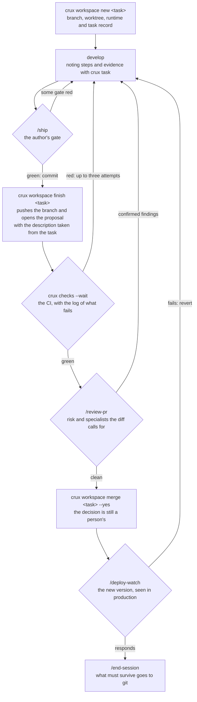

<p align="center">
  
</p>

# crux

The *crux* is the key move of a climbing route: the point on which everything
else depends.

This repo is the **kernel of the agent workflow system**. It contains the
documentation standard, the cross-cutting skills, the templates and the
tooling that every project uses. It is installed once per machine and from it
each project's documentation repos are launched and maintained.

It is not a project's documentation repo. It is what produces them.

---

## Installation

You need `bash`, `git` and `node`, and nothing else. The code stays within what
bash 3.2 understands, which is what macOS ships with.

### 1. Clone and run the installer

```bash
git clone git@github.com:jocarrd/crux.git ~/Proyectos/crux
~/Proyectos/crux/install.sh
```

Where you clone it decides where your projects will live: the root is the
kernel's parent directory. If you put it in `/opt/dev/crux`, your projects go
in `/opt/dev`. You can change it with `--projects-dir <path>`, although it is
better for the kernel to live next to them.

If you work on the kernel itself with its own docs repo, clone it inside a
project folder like any other code: `~/Proyectos/crux/crux`, next to
`~/Proyectos/crux/crux-docs`. The root is then the folder above the project.

### 2. What it leaves installed

| What | Where | What for |
| ---- | ----- | -------- |
| The kernel version | `~/.crux/kernel/<version>/` | It is the copy your projects run |
| The command | `~/.local/bin/crux` → that copy | Use `crux` from any directory |
| The skills | `~/.claude/skills/` and `~/.codex/prompts/` | Invoke them with `/<name>` |
| Machine config | `~/.crux/config` | Where the kernel lives, the projects root and your preferences |

Make sure `~/.local/bin` is in your `PATH`. To check whether the machine is
missing anything the skills need:

```bash
crux doctor --machine
```

### 3. The two modes

**Release**, which is the default. The installer copies the version and
everything points to that copy, so you can tinker with the kernel or leave a
branch half done without changing the behavior of any project. To move to a new
version, run `install.sh` again. The previous ones stay in `~/.crux/kernel/` in
case you need to go back.

**Dev**, with `install.sh --dev`. It links directly to the working copy, so any
change in the kernel is immediate in every project. It is meant for the machine
where you develop crux. It refuses to run from a worktree, because closing it
would leave the machine without skills.

```bash
grep CRUX_MODE ~/.crux/config    # which one you are in
```

### 4. Bringing a project that already exists

```bash
crux clone <project>     # docs repo + code repos + pointers
```

### 5. Starting on a machine with nothing on it

```bash
crux bootstrap           # verifies the machine, discovers the projects and brings them
crux bootstrap --dry-run # what it would bring, without touching the disk
```

The list of projects comes from the remote —the `*-docs` repos that carry a
contract— and not from an inventory in a file, which goes stale as soon as you
create a project and is consulted precisely on the day you do not remember
which ones you had.

It moves no credentials: SSH keys, tokens and secrets are not copied from one
machine to another by a tool. When it finishes it says what each project needs
and in which document it is described.

If the project is already on disk but does not yet follow the standard, run
`crux adopt` in its docs repo and then `crux upgrade`, which materializes the
missing pieces.

### 6. Alternating between two machines

```bash
crux sync                # on arrival: what is on this machine, up to date, and the kernel
crux sync --leave        # on leaving: fails if something would be left only here
```

`bootstrap` and `clone` bring what is missing, but do not update what is
already there. On returning to a computer after a while, they said "done" and
left the code as you left it the last time you used it. `sync` covers that
case.

On arrival it walks what is already in the projects root —docs repos, code
repos and loose repos—, fetches their remotes and fast-forwards every clean
branch that is behind, including those not in use, such as `main` while you
work on another. Two syncs do not run at once: the second waits, or backs off
if it is the hook's. It does not bring projects this machine does not have:
each one has its own, and `crux clone` exists to bring one. If a project here
declares a repo that was added from the other machine, that one it does clone,
because it belongs to the same project. It also installs the latest published
version of the kernel with its hooks. If a branch has uncommitted changes or has
diverged from its remote, it says so and does not touch it: joining them is a
decision and a script does not make it.

`crux hooks install` hooks the same thing into the agent's session start. At
most once every ten minutes, so that several sessions open at once do not
repeat the round. It only speaks if something changed or there is something to
decide.

`--leave` lists what would not reach the other machine: uncommitted changes,
unpushed commits, branches that are on no remote, commits made on a detached
HEAD and repos whose remote no longer exists. That last one is the only thing
that needs the network: with the remote deleted, git still believes everything
is pushed. Stashes show up as a warning, because they do not travel. Branches
that tracked a branch since deleted from the remote, which are almost always
squash-merged proposals, do not block.

The first time on a machine with a kernel older than this command, `sync` does
not exist yet: update the kernel clone (`git -C ~/Proyectos/crux pull`), run
its `install.sh` and `crux hooks install`, and launch `crux sync`. From then on
the hook does it.

Tasks travel too: `sync` brings those from the other machine and publishes
what was left pending here, and `--leave` fails if any could not be published.
When opening or resuming a session, the hook shows the open tasks as a
reminder, without pushing you to resume them; also on returning to a session
that had been idle for more than three hours (`CRUX_TASKS_IDLE_HOURS`). Those
whose proposal was merged outside `crux merge` close themselves instead of
showing up in every reminder.

It does not sync credentials, which are carried with `carry-env`, nor the
agent's personal memories, which belong to each machine.

### When something does not go as expected

| Symptom | What is happening and what to do |
| ------- | -------------------------------- |
| **A project's code was not cloned** | `client-repo` profile: the code lives on the client's remote and `crux clone` does not bring it. Clone it yourself as a sibling of the docs repo (`git clone` in `~/Proyectos/<project>/`). |
| **A repo is in another account or organization** | Declare the override in `crux.json` → `remote.repos["<repo>"]` with its URL. Without that, `clone` does not know where to fetch it from and `doctor` warns about it. |
| **`crux init` does not know where to push** | The remote template is missing. Pass it with `--remote 'git@github.com:<org>/{repo}.git'`, set it in `~/.crux/config` (`CRUX_REMOTE`), or create only locally with `--no-remote`. |
| **You want the docs repo in an organization** | Declare the org in the remote template (`…:<org>/{repo}.git`): `crux init` creates the repo there, not in your personal account. You need write permission in the org. |
| **`bootstrap` finds no projects** | The list comes from the `*-docs` repos with `crux.json`. If `gh` is missing or you are not authenticated, it cannot discover them: `gh auth login` and repeat. |

### Preferences

They go in `~/.crux/config`. They belong to the machine and not to the project,
so each person can close their cycle their own way without changing the
contract the others share.

| Key | Default | What it does |
| --- | ------- | ------------ |
| `CRUX_REMOTE` | — | Remote template for the projects you create |
| `CRUX_PROJECTS_DIR` | the parent of the kernel clone | Where the projects live |
| `CRUX_MERGE_CLOSE_WORKSPACE` | `true` | Closes the space on merge; `false` leaves it alive |
| `CRUX_RM_DELETE_BRANCH` | `false` | Also deletes the local branch when closing the space, as long as it is already integrated |
| `CRUX_UNMANAGED` | — | Paths or patterns separated by `:` that live under the root without being yours, such as someone else's clone: the cycle reminder ignores them |

### Uninstalling

```bash
rm -rf ~/.crux ~/.local/bin/crux
find ~/.claude/skills ~/.codex/prompts -maxdepth 1 -type l ! -exec test -e {} \; -delete
```

The docs repos and the code repos are not touched.

## The work cycle

A development task enters through an isolated space and leaves as a reviewed
proposal. `/flow` is the default entry point: it chains the skills in this
order and explains why it is that one and not another.



The two review steps answer different questions, which is why they do not
overlap. `/ship` asks whether what you did is ready: tests, diff read,
correctness, regression. It is passed by whoever wrote the change, before
committing.

`/review-pr` asks whether what is proposed is correct and complete, and it is
done from an independent context. Whoever has just defended each decision is
not in a position to refute them, and there is a gap that is only visible from
outside: fixing a problem through the door where it was found and leaving it
open through another.

### The task: resuming without reconstructing

Each workspace has a task with its record in
`~/.crux/tasks/<project>/<task>.md`: goal, scope, plan, steps with their
evidence, next step, decisions taken along the way and what was verified.

```bash
crux workspace new passkeys --goal "Sign in with a passkey, no password"
crux task add "passkey registration" "login" "account recovery"
crux task done T1 "green e2e test of the registration, screenshot of the dialog"
crux task note "Recovery still goes by email" --why "the provider does not support backup passkeys" \
  --where "src/auth/recovery.ts" --learned "Safari requires a user gesture to create the passkey"
crux task next "try the login in Safari"
crux task                          # state, steps and next step
```

A note with `--why` is a **decision**: when the task is archived, crux moves it
to `repos/<repo>/notes.md` in the docs repo and commits it, because the task
record is local and the next session does not read it. Notes without a why are
deviations from the plan and stay in the task. They are noted at the time, not
at close.

The commands write it, you do not have to edit it by hand:

| Moment | What happens in the record | State |
| ------ | ----------------------------------- | ----- |
| `crux workspace new` | It is created; with `--task` another repo joins the same task | `open` |
| `crux task plan <file>` | The approved plan is written down | `planned` |
| `crux task done` | The step is marked with what proves it | `in-progress` |
| `crux ship seal` | The gate's receipt is dumped as evidence | `verified` |
| `crux workspace finish` | The proposal's description comes from here | `proposed` |
| `crux workspace merge --yes` | The merge is noted | `merged` |
| `crux workspace rm` | When its last space closes, if merged, it is archived in `done/` | `closed` |

When another person's answer is missing, the task **waits** without taking up
space:

```bash
crux task wait --on "Alex" --ask "shall we point the domain at the new server?" --ref "email of 3 Oct"
```

It notes who, what and since when; it removes the space and the branch if they
hold nothing of their own, and the reminder shows it separately ("waiting on
Alex, 4 days ago"), with a nudge to follow up at 7. `crux workspace resume`
picks it up again.

**It does not pile up.** Archived tasks drop out of the lists and expire after
180 days with `crux workspace gc --yes` (`CRUX_TASKS_RETENTION_DAYS` to change
it).

When resuming a space —another session, after a restart or the next day— a
hook brings the state and the next step in two lines. `crux workspace list`
shows the same for each space.

**It lives outside the code repos on purpose.** A client's repo cannot be
written to, and a multi-repo task would be split. Nor does it go on `main` of
the docs repo, which is what is read as truth: a half-finished plan would be
read as a decision. What deserves to outlive the task is promoted there on
close.

**And yet it travels.** It is replicated on the docs repo's `crux/tasks`
branch, which `main` does not see: it publishes itself after each write and
`crux sync` brings it on arriving at another machine. There,
`crux workspace resume <task>` opens the space from the remote branch and
joins it to the task with its plan and its next step. See ADR-016.

**It costs little.** A full cycle with the record takes 0.9 s of machine time
against 0.35 s without it; opening the task with its goal and its plan are two
calls, and the hook adds about 60 tokens once per session.

### What holds it up when nobody remembers

These guards enforce the cycle without depending on anyone's memory. They are
installed by `crux hooks install`:

| Guard | What it prevents |
| ----- | ---------------- |
| `pre-push` on the main branch | Pushing to the main branch of a code repo or of the kernel without going through a proposal. The docs repo is pushed directly, as its rule says |
| `commit-msg` | Commit messages outside the standard's language |
| `.crux-ship` | Opening a proposal from a commit that has not passed `/ship` |
| `.crux-visual` | Publishing in the proposal screenshots approved on another commit |
| Task hook on resume | Continuing a half-done task without knowing where it was left |
| Worktree guard | Deleting a registered space by hand (`git worktree remove`, `rm -rf`) and leaving the registry lying |
| Destructive guard | `git reset --hard`, `push --force`, `clean -fd`, discarding the tree, `rm -r` on `/`, `~`, `.` or `*`, `pkill`/`killall`, and reading private keys or credentials. Whoever really wants it runs it with `! <command>` |
| Proposal guard | Hand-opening with `gh pr create` a proposal in a crux project, skipping the receipt that `crux workspace finish` demands |
| Plan warning in `finish` | Nothing: it warns when a proposal goes past 100 written lines and its task has no saved plan (`crux task plan`) |
| Self-repairing registry | Entries of spaces whose folder and branch no longer exist; `new`, `list` and `status` remove them |
| `crux doctor` at close | Closing the session with the project outside the standard |
| `crux memory` at close | Closing the session with project knowledge only on this machine |

## Commands

| Command | What it does |
| ------- | ------------ |
| `crux init <project>` | Creates `~/Proyectos/<project>/<project>-docs` from the templates |
| `crux clone <project>` | Brings a whole project onto a new machine |
| `crux bootstrap` | Gets a new machine ready: verifies, discovers all the projects and brings them |
| `crux adopt` | Registers a docs repo that already exists under the standard |
| `crux add-repo <repo>` | Registers a new repo in an adopted project |
| `crux archive <repo> --reason "…"` | Marks a repo as archived, out of production but kept |
| `crux unarchive <repo>` | Brings an archived repo back |
| `crux link` | Creates and verifies the pointers of the project's code repos |
| `crux workspace` | Isolated spaces with worktree, ports and database, with proposal, merge and pickup |
| `crux task` | Each space's task record: steps with evidence, next step and state, outside the repos |
| `crux ship` | The quality gate: runs the checks and leaves a receipt of what was run and with what result. `workspace finish` demands it. |
| `crux visual` | The approved visual review: notes the decision-maker's yes on the commit and `workspace finish` puts the before and after in the proposal. |
| `crux review` | Gathers the material to review a proposal: commits, diff, checks, signals, risk and specialists |
| `crux checks [n]` | Waits for a proposal's CI and brings only the end of the log of what fails |
| `crux merge <n>` | Merges a proposal after saying which one it is and from which repository |
| `crux doctor` | Verifies a docs repo's conformance with the standard |
| `crux doctor --machine` | Verifies that the machine has what the skills need |
| `crux hooks` | Hooks the standard into the cycle, the session close and the commit |
| `crux mcp` | Writes into each repo the MCP servers the project declares, and says whether they respond |
| `crux stg` | Publishes a built folder to a keyed staging, to show work without publishing it |
| `crux usage` | Which skills are actually used |
| `crux skill test <skill> [--against <ref>]` | Runs a skill's scenarios and flags what changes compared with another version |
| `crux memory` | Agent memories that are still only local: the project's go to its docs repo, the person's to the profile; `search <text>` looks in both |
| `crux profile` | The person's profile: preferences, who they are and what holds on each machine, in a repo of its own that every agent loads |
| `crux status` | What is open right now across all projects |
| `crux sync` | Up to date with the remote on arriving at a machine; `--leave` checks that you leave nothing trapped when you go |
| `crux upgrade` | Re-materializes the kernel in a project at the current version |
| `crux release <ver>` | Publishes a version, first checking that the projects remain conformant |

Any of them accepts `--help`, and all of them also exist as skills:
`/crux-init`, `/crux-doctor`, etc.

Complete guide, from simple to deep: `GUIA.md`. If you are going to work on
this repo, start with `AGENTS.md`.

## The three layers

| Layer | What it is | Where it lives |
| ----- | ---------- | -------------- |
| **Kernel** | Standard, cross-cutting skills, templates, tooling | this repo |
| **Project** | The project's documentation and its own skills | `<project>-docs/` |
| **Repo** | Context pointers, generated | each code repo |

Each docs repo declares its contract with the kernel in a `crux.json`:

```json
{
  "crux": "0.13.1",
  "project": "acme",
  "profile": "multi-repo",
  "branch": "main",
  "repos": ["Acme", "acme-engine", "acme-cms"],
  "sections": ["architecture", "conventions", "operations", "topics"]
}
```

`crux doctor` warns when the declared version and the installed one stop
matching.

## Supported agents

Knowledge is written once in neutral markdown and the installer materializes it
for each agent:

| Piece | Claude Code | Codex |
| ----- | ----------- | ----- |
| Skill | symlink in `~/.claude/skills/` | stub in `~/.codex/prompts/` |
| Global context | `~/.claude/CLAUDE.md` | `~/.codex/AGENTS.md` |
| Project context | `CLAUDE.md` (symlink) | `AGENTS.md` (canonical) |
| Repo pointer | `CLAUDE.md` with `@-import` | `AGENTS.md` with path |

That is where the rule comes from that no skill mention the tools of a specific
agent: they describe the action, not who runs it.

## Structure

```
crux/
├── AGENTS.md        context for working on the kernel (CLAUDE.md → symlink)
├── STANDARD.md      the complete standard, and the skill catalog
├── GUIA.md          how everything works, from start to finish
├── VERSION
├── install.sh       once per machine
├── bin/             one file per command
├── lib/             path verifiers and common utilities
├── templates/       docs-repo/ and code-repo/
├── profiles/        multi-repo, client-repo
├── adapters/        claude/, codex/
├── skills/          the cross-cutting skills
└── test/            suite and end-to-end battery
```

## Tests

```bash
./test/run.sh            # all the cases
./test/run.sh doctor     # only those matching the pattern
./test/e2e.sh            # the whole cycle against a local remote
```

Each case runs in an isolated sandbox with the agent directories redirected, so
the suite does not touch `~/.claude`, `~/.codex` or `~/Proyectos`.

The suite tests individual pieces and `e2e.sh` tests the complete journey:
creating the project, registering a repo, installing the guards, checking that
a direct push is blocked, opening a space, passing the gate, proposing and
recovering the project on another machine. The failures that have cost the most
showed up there and not in the suite, because they only appear when the pieces
are used in sequence.

Two cases watch over the kernel itself: that no skill ties itself to a specific
agent and that the name of no project appears. They are what stop crux from
coupling itself again to what it documents.

## Governance

On every push and every proposal, the CI runs static analysis, the suite, the
end-to-end battery and a clean installation.

`crux hooks install` closes the main branch so that work enters through a
proposal, and reminds you of the cycle when starting on it. The latter is there
because we measured that describing it in a skill was not enough.

`crux release <ver>` publishes a version and first checks that the projects
that consume the kernel remain conformant. That is the difference from a
`git tag`: changing the standard and breaking whoever uses it without noticing
is exactly what a release must prevent. The number is bumped in `VERSION` per
proposal, like any other change; the command only tags.

Projects that consume it today: `acme-docs`, `client-docs`.
