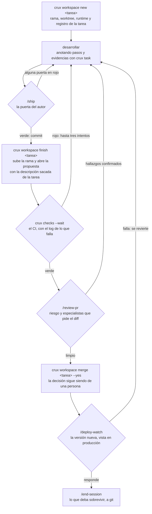

<p align="center">
  
</p>

# crux

El *crux* es el paso clave de una vía: el punto del que depende todo lo demás.

Este repo es el **kernel del sistema de trabajo con agentes**. Contiene el
estándar de documentación, las skills transversales, las plantillas y el
tooling que usan todos los proyectos. Se instala una vez por máquina y desde
él se lanzan y se mantienen los repos de documentación de cada proyecto.

No es un repo de documentación de un proyecto. Es lo que los fabrica.

---

## Instalación

Hacen falta `bash`, `git` y `node`, y nada más. El código se mantiene dentro de
lo que entiende bash 3.2, que es el que trae macOS de serie.

### 1. Clonar y ejecutar el instalador

```bash
git clone git@github.com:jocarrd/crux.git ~/Proyectos/crux
~/Proyectos/crux/install.sh
```

El sitio donde lo clones decide dónde van a vivir tus proyectos: la raíz es el
directorio padre del kernel. Si lo pones en `/opt/dev/crux`, tus proyectos van
en `/opt/dev`. Puedes cambiarlo con `--projects-dir <ruta>`, aunque conviene
que el kernel viva junto a ellos.

### 2. Qué deja instalado

| Qué | Dónde | Para qué |
| --- | ----- | -------- |
| La versión del kernel | `~/.crux/kernel/<version>/` | Es la copia que ejecutan tus proyectos |
| El comando | `~/.local/bin/crux` → esa copia | Usar `crux` desde cualquier directorio |
| Las skills | `~/.claude/skills/` y `~/.codex/prompts/` | Invocarlas con `/<nombre>` |
| Config de máquina | `~/.crux/config` | Dónde vive el kernel, la raíz de proyectos y tus preferencias |

Asegúrate de tener `~/.local/bin` en el `PATH`. Para comprobar si a la máquina
le falta algo de lo que las skills necesitan:

```bash
crux doctor --machine
```

### 3. Los dos modos

**Release**, que es el de por defecto. El instalador copia la versión y todo
apunta a esa copia, así que puedes trastear en el kernel o dejarte una rama a
medias sin que cambie el comportamiento de ningún proyecto. Para pasar a una
versión nueva, vuelve a ejecutar `install.sh`. Las anteriores se quedan en
`~/.crux/kernel/` por si hay que volver atrás.

**Dev**, con `install.sh --dev`. Enlaza directamente al working copy, de modo
que cualquier cambio en el kernel es inmediato en todos los proyectos. Sirve
para la máquina donde desarrollas crux. Se niega a ejecutarse desde un
worktree, porque al cerrarlo la máquina se quedaría sin skills.

```bash
grep CRUX_MODE ~/.crux/config    # en cuál estás
```

### 4. Traer un proyecto que ya existe

```bash
crux clone <project>     # docs repo + repos de código + punteros
```

### 5. Empezar en una máquina donde no hay nada

```bash
crux bootstrap           # verifica la máquina, descubre los proyectos y los trae
crux bootstrap --dry-run # qué traería, sin tocar el disco
```

La lista de proyectos sale del remoto —los repos `*-docs` que llevan contrato— y
no de un inventario en un fichero, que se desactualiza en cuanto creas un
proyecto y se consulta justamente el día en que no te acuerdas de cuáles tenías.

No mueve credenciales: las claves SSH, los tokens y los secretos no se copian de
una máquina a otra por una herramienta. Al terminar dice qué necesita cada
proyecto y en qué documento está.

Si el proyecto ya está en disco pero todavía no sigue el estándar, ejecuta
`crux adopt` en su docs repo y después `crux upgrade`, que materializa las
piezas que falten.

### 6. Alternar entre dos máquinas

```bash
crux sync                # al llegar: lo que hay en esta máquina, al día, y el kernel
crux sync --leave        # al irte: falla si algo se quedaría solo aquí
```

`bootstrap` y `clone` traen lo que no está, pero no actualizan lo que ya hay.
Al volver a un ordenador después de un tiempo, decían "ya está" y dejaban el
código tal como lo dejaste la última vez que lo usaste. `sync` cubre ese caso.

Al llegar recorre lo que ya hay en la raíz de proyectos —docs repos, repos de
código y repos sueltos—, trae sus remotos y avanza cada rama limpia que va por
detrás, también las que no están en uso, como `main` mientras trabajas en otra.
Dos sincronizaciones no corren a la vez: la segunda espera, o se retira si es
la del hook. No trae proyectos que esta máquina no tenga: cada una tiene los suyos, y
para traer uno está `crux clone`. Si un proyecto de aquí declara un repo que se
añadió desde la otra máquina, ese sí lo clona, porque es del mismo proyecto.
También instala la última versión publicada del kernel con sus hooks. Si una rama tiene
cambios sin commitear o se ha separado de su remoto, lo dice y no la toca:
juntarlas es una decisión y no la toma un script.

`crux hooks install` engancha lo mismo al inicio de sesión del agente. Como
mucho una vez cada diez minutos, para que varias sesiones abiertas a la vez no
repitan la ronda. Solo habla si algo cambió o hay algo que decidir.

`--leave` enumera lo que no llegaría a la otra máquina: cambios sin commitear,
commits sin subir, ramas que no están en ningún remoto, commits hechos con HEAD
separado y repos cuyo remoto ya no existe. Esto último es lo único que necesita
red: con el remoto borrado, git sigue creyendo que todo está subido. Los
stashes salen como aviso, porque no viajan. Las ramas que seguían a una rama ya borrada del
remoto, que casi siempre son propuestas fusionadas con squash, no bloquean.

La primera vez en una máquina con un kernel anterior a este comando, `sync` no
existe todavía: actualiza el clon del kernel (`git -C ~/Proyectos/crux pull`),
ejecuta su `install.sh` y `crux hooks install`, y lanza `crux sync`. A partir de
ahí lo hace el hook.

Las tareas también viajan: `sync` trae las de la otra máquina y publica lo que
aquí quedó pendiente, y `--leave` falla si alguna no se ha podido publicar. Al
abrir o retomar una sesión, el hook enseña las tareas abiertas como
recordatorio, sin empujar a retomarlas; también al volver a una sesión que
llevaba más de tres horas parada (`CRUX_TASKS_IDLE_HOURS`). Las que tienen su
propuesta fusionada fuera de `crux merge` se cierran solas en vez de aparecer
en cada recordatorio.

No sincroniza credenciales, que se llevan con `carry-env`, ni las memorias
personales del agente, que son de cada máquina.

### Cuando algo no sale como esperabas

| Síntoma | Qué pasa y qué hacer |
| ------- | -------------------- |
| **El código de un proyecto no se clonó** | Perfil `client-repo`: el código vive en el remoto del cliente y `crux clone` no lo trae. Clónalo tú como hermano del docs repo (`git clone` en `~/Proyectos/<project>/`). |
| **Un repo está en otra cuenta u organización** | Declara el override en `crux.json` → `remote.repos["<repo>"]` con su URL. Sin eso, `clone` no sabe de dónde traerlo y `doctor` lo avisa. |
| **`crux init` no sabe dónde subir** | Falta la plantilla del remoto. Pásala con `--remote 'git@github.com:<org>/{repo}.git'`, fíjala en `~/.crux/config` (`CRUX_REMOTE`), o crea solo en local con `--no-remote`. |
| **Quieres el docs repo en una organización** | Declara la org en la plantilla del remoto (`…:<org>/{repo}.git`): `crux init` crea el repo ahí, no en tu cuenta personal. Necesitas permiso de escritura en la org. |
| **`bootstrap` no encuentra proyectos** | La lista sale de los repos `*-docs` con `crux.json`. Si falta `gh` o no estás autenticado, no puede descubrirlos: `gh auth login` y repite. |

### Preferencias

Van en `~/.crux/config`. Son de la máquina y no del proyecto, así que cada uno
puede cerrar su ciclo a su manera sin cambiar el contrato que comparten los
demás.

| Clave | Por defecto | Qué hace |
| ----- | ----------- | -------- |
| `CRUX_REMOTE` | — | Plantilla del remoto para los proyectos que crees |
| `CRUX_PROJECTS_DIR` | el padre del clon del kernel | Dónde viven los proyectos |
| `CRUX_MERGE_CLOSE_WORKSPACE` | `true` | Cierra el espacio al fusionar; `false` lo deja vivo |
| `CRUX_RM_DELETE_BRANCH` | `false` | Borra también la rama local al cerrar el espacio, siempre que ya esté integrada |
| `CRUX_UNMANAGED` | — | Rutas o patrones separados por `:` que viven bajo la raíz sin ser tuyos, como un clon ajeno: el recordatorio del ciclo los ignora |

### Desinstalar

```bash
rm -rf ~/.crux ~/.local/bin/crux
find ~/.claude/skills ~/.codex/prompts -maxdepth 1 -type l ! -exec test -e {} \; -delete
```

Los docs repos y los repos de código no se tocan.

## El ciclo de trabajo

Una tarea de desarrollo entra por un espacio aislado y sale como propuesta
revisada. `/flow` es la entrada por defecto: encadena las skills en este orden
y explica por qué es ese y no otro.



Los dos pasos de revisión responden preguntas distintas, y por eso no se
solapan. `/ship` pregunta si está listo lo que hiciste: tests, diff leído,
correctitud, regresión. La pasa quien escribió el cambio, antes de commitear.

`/review-pr` pregunta si es correcto y completo lo que se propone, y se hace
desde un contexto independiente. Quien acaba de defender cada decisión no está
en posición de refutarlas, y hay un hueco que solo se ve desde fuera: arreglar
un problema por la puerta por la que se encontró y dejarlo abierto por otra.

### La tarea: retomar sin reconstruir

Cada espacio de trabajo tiene una tarea con su registro en
`~/.crux/tasks/<proyecto>/<tarea>.md`: objetivo, alcance, plan, pasos con su
evidencia, siguiente paso, decisiones tomadas por el camino y lo comprobado.

```bash
crux workspace new passkeys --goal "Entrar con passkey, sin contraseña"
crux task add "registro de la passkey" "login" "recuperación de cuenta"
crux task done T1 "test e2e del registro en verde, captura del diálogo"
crux task note "La recuperación sigue por correo" --why "el proveedor no admite passkeys de respaldo" \
  --where "src/auth/recovery.ts" --learned "Safari pide el gesto del usuario para crear la passkey"
crux task next "probar el login en Safari"
crux task                          # estado, pasos y siguiente paso
```

Una nota con `--why` es una **decisión**: al archivar la tarea, crux la pasa a
`repos/<repo>/notes.md` del docs repo y la commitea, porque el registro de la
tarea es local y la siguiente sesión no lo lee. Las notas sin porqué son
desviaciones del plan y se quedan en la tarea. Se anotan en el momento, no al
cerrar.

Lo escriben los comandos, no hay que editarlo a mano:

| Momento | Qué pasa en el registro | Estado |
| ------- | ----------------------- | ------ |
| `crux workspace new` | Se crea; con `--task` otro repo se une a la misma tarea | `open` |
| `crux task plan <fichero>` | El plan aprobado queda escrito | `planned` |
| `crux task done` | El paso se marca con lo que lo prueba | `in-progress` |
| `crux ship seal` | Se vuelca el recibo de la puerta como evidencia | `verified` |
| `crux workspace finish` | La descripción de la propuesta sale de aquí | `proposed` |
| `crux workspace merge --yes` | Se anota la fusión | `merged` |
| `crux workspace rm` | Al cerrar su último espacio, si está fusionada, se archiva en `done/` | `closed` |

Cuando falta la respuesta de otra persona, la tarea **espera** sin ocupar sitio:

```bash
crux task wait --on "Alex" --ask "¿apuntamos el dominio al servidor nuevo?" --ref "correo del 3-10"
```

Apunta a quién, qué y desde cuándo; retira el espacio y la rama si no tienen
nada propio, y el recordatorio la enseña aparte («esperando a Alex, hace 4
días»), con aviso de insistir a los 7. `crux workspace resume` la retoma.

**No se acumula.** Las archivadas salen de las listas y caducan a los 180 días
con `crux workspace gc --yes` (`CRUX_TASKS_RETENTION_DAYS` para cambiarlo).

Al retomar un espacio —otra sesión, tras un reinicio o al día siguiente— un
hook trae el estado y el siguiente paso en dos líneas. `crux workspace list`
enseña lo mismo por cada espacio.

**Vive fuera de los repos de código a propósito.** En el de un cliente no se
puede escribir, y una tarea de varios repos se partiría. Tampoco va en `main`
del docs repo, que es lo que se lee como verdad: un plan a medias se leería como
una decisión. Lo que merece sobrevivir a la tarea se promociona allí al cerrar.

**Y aun así viaja.** Se replica en la rama `crux/tasks` del docs repo, que
`main` no ve: se publica sola tras cada escritura y `crux sync` la trae al
llegar a otra máquina. Allí, `crux workspace resume <tarea>` abre el espacio
desde la rama remota y lo une a la tarea con su plan y su siguiente paso. Ver
ADR-016.

**Cuesta poco.** Un ciclo completo con registro tarda 0,9 s de máquina frente a
0,35 s sin él; abrir la tarea con su objetivo y su plan son dos llamadas, y el
hook añade unos 60 tokens una vez por sesión.

### Qué lo sostiene cuando nadie se acuerda

Estas guardas hacen cumplir el ciclo sin depender de la memoria de nadie. Las
instala `crux hooks install`:

| Guarda | Qué impide |
| ------ | ---------- |
| `pre-push` en la rama principal | Empujar a la principal de un repo de código o del kernel sin pasar por propuesta. El repo de docs se sube directo, como dice su regla |
| `commit-msg` | Mensajes de commit fuera del idioma del estándar |
| `.crux-ship` | Abrir propuesta de un commit que no ha pasado `/ship` |
| `.crux-visual` | Publicar en la propuesta capturas aprobadas sobre otro commit |
| Hook de la tarea al retomar | Seguir una tarea a medias sin saber en qué punto quedó |
| Guardia de worktrees | Borrar a mano un espacio registrado (`git worktree remove`, `rm -rf`) y dejar el registro mintiendo |
| Guardia destructivo | `git reset --hard`, `push --force`, `clean -fd`, descartar el árbol, `rm -r` sobre `/`, `~`, `.` o `*`, `pkill`/`killall`, y leer claves privadas o credenciales. Quien lo quiera de verdad lo ejecuta con `! <comando>` |
| Guardia de propuestas | Abrir a mano con `gh pr create` una propuesta en un proyecto de crux, saltándose el recibo que exige `crux workspace finish` |
| Aviso de plan en `finish` | Nada: avisa cuando una propuesta pasa de 100 líneas escritas y su tarea no tiene plan guardado (`crux task plan`) |
| Registro que se repara solo | Entradas de espacios cuya carpeta y rama ya no existen; `new`, `list` y `status` las retiran |
| `crux doctor` en el cierre | Cerrar sesión con el proyecto fuera del estándar |
| `crux memory` en el cierre | Cerrar sesión con conocimiento del proyecto solo en esta máquina |

## Comandos

| Comando | Qué hace |
| ------- | -------- |
| `crux init <project>` | Crea `~/Proyectos/<project>/<project>-docs` desde las plantillas |
| `crux clone <project>` | Trae un proyecto entero a una máquina nueva |
| `crux bootstrap` | Deja una máquina nueva lista: verifica, descubre todos los proyectos y los trae |
| `crux adopt` | Registra un docs repo que ya existe bajo el estándar |
| `crux add-repo <repo>` | Registra un repo nuevo en un proyecto adoptado |
| `crux link` | Crea y verifica los punteros de los repos de código del proyecto |
| `crux workspace` | Espacios aislados con worktree, puertos y base de datos, con propuesta, fusión y recogida |
| `crux task` | El registro de la tarea de cada espacio: pasos con evidencia, siguiente paso y estado, fuera de los repos |
| `crux ship` | La puerta de calidad: ejecuta las comprobaciones y deja un recibo de lo que se ejecutó y con qué resultado. `workspace finish` lo exige. |
| `crux visual` | La revisión visual aprobada: anota el sí de quien decide sobre el commit y `workspace finish` pone el antes y el después en la propuesta. |
| `crux review` | Reúne el material para revisar una propuesta: commits, diff, checks, señales, riesgo y especialistas |
| `crux checks [n]` | Espera al CI de una propuesta y trae solo el final del log de lo que falla |
| `crux merge <n>` | Mergea una propuesta tras decir cuál es y de qué repositorio |
| `crux doctor` | Verifica la conformidad de un docs repo con el estándar |
| `crux doctor --machine` | Verifica que la máquina tiene lo que las skills necesitan |
| `crux hooks` | Engancha el estándar al ciclo, al cierre de sesión y al commit |
| `crux mcp` | Escribe en cada repo los servidores MCP que el proyecto declara, y dice si responden |
| `crux stg` | Publica una carpeta construida en un staging con clave, para enseñar trabajo sin publicarlo |
| `crux usage` | Qué skills se usan de verdad |
| `crux skill test <skill> [--against <ref>]` | Pasa los escenarios de una skill y marca lo que cambia respecto a otra versión |
| `crux memory` | Memorias del agente que son del proyecto y siguen solo en local |
| `crux status` | Qué hay abierto ahora mismo en todos los proyectos |
| `crux sync` | Al día con el remoto al llegar a una máquina; `--leave` comprueba que no dejas nada atrapado al irte |
| `crux upgrade` | Re-materializa el kernel en un proyecto a la versión actual |
| `crux release <ver>` | Publica una versión, comprobando antes que los proyectos siguen conformes |

Cualquiera acepta `--help`, y todos existen también como skills: `/crux-init`,
`/crux-doctor`, etc.

Guía completa, de lo sencillo a lo profundo: `GUIA.md`. Si vas a trabajar en
este repo, empieza por `AGENTS.md`.

## Las tres capas

| Capa | Qué es | Dónde vive |
| ---- | ------ | ---------- |
| **Kernel** | Estándar, skills transversales, plantillas, tooling | este repo |
| **Proyecto** | Documentación del proyecto y sus skills propias | `<project>-docs/` |
| **Repo** | Punteros de contexto, generados | cada repo de código |

Cada docs repo declara su contrato con el kernel en un `crux.json`:

```json
{
  "crux": "0.13.1",
  "project": "acme",
  "profile": "multi-repo",
  "branch": "main",
  "repos": ["Acme", "acme-engine", "acme-cms"],
  "sections": ["architecture", "conventions", "operations", "topics"]
}
```

`crux doctor` avisa cuando la versión declarada y la instalada dejan de
coincidir.

## Agentes soportados

El conocimiento se escribe una vez en markdown neutro y el instalador lo
materializa para cada agente:

| Pieza | Claude Code | Codex |
| ----- | ----------- | ----- |
| Skill | symlink en `~/.claude/skills/` | stub en `~/.codex/prompts/` |
| Contexto global | `~/.claude/CLAUDE.md` | `~/.codex/AGENTS.md` |
| Contexto de proyecto | `CLAUDE.md` (symlink) | `AGENTS.md` (canónico) |
| Puntero de repo | `CLAUDE.md` con `@-import` | `AGENTS.md` con ruta |

De ahí viene la regla de que ninguna skill mencione herramientas propias de un
agente concreto: describen la acción, no quién la ejecuta.

## Estructura

```
crux/
├── AGENTS.md        contexto para trabajar en el kernel (CLAUDE.md → symlink)
├── STANDARD.md      el estándar completo, y el catálogo de skills
├── GUIA.md          cómo funciona todo, de principio a fin
├── VERSION
├── install.sh       una vez por máquina
├── bin/             un fichero por comando
├── lib/             verificadores de paths y utilidades comunes
├── templates/       docs-repo/ y code-repo/
├── profiles/        multi-repo, client-repo
├── adapters/        claude/, codex/
├── skills/          las skills transversales
└── test/            suite y batería de extremo a extremo
```

## Tests

```bash
./test/run.sh            # todos los casos
./test/run.sh doctor     # solo los que casan con el patrón
./test/e2e.sh            # el ciclo entero contra un remoto local
```

Cada caso corre en un sandbox aislado con los directorios de agentes
redirigidos, así que la suite no toca `~/.claude`, `~/.codex` ni `~/Proyectos`.

La suite prueba piezas sueltas y `e2e.sh` prueba el recorrido completo: crear
el proyecto, registrar un repo, instalar las guardas, comprobar que el push
directo se bloquea, abrir un espacio, pasar la puerta, proponer y recuperar el
proyecto en otra máquina. Los fallos que más han costado aparecieron ahí y no
en la suite, porque solo se ven cuando las piezas se usan seguidas.

Dos casos vigilan el propio kernel: que ninguna skill se ate a un agente
concreto y que no aparezca el nombre de ningún proyecto. Son los que evitan que
crux vuelva a acoplarse a lo que documenta.

## Gobernanza

En cada push y cada propuesta, el CI pasa análisis estático, la suite, la
batería de extremo a extremo y una instalación en limpio.

`crux hooks install` cierra la rama principal para que el trabajo entre por
propuesta, y recuerda el ciclo al empezar sobre ella. Lo segundo está ahí
porque medimos que describirlo en una skill no bastaba.

`crux release <ver>` publica una versión y antes comprueba que los proyectos
que consumen el kernel siguen conformes. Es la diferencia con un `git tag`:
cambiar el estándar y romper a quien lo usa sin enterarse es justo lo que un
release debe impedir. El número se sube en `VERSION` por propuesta, como
cualquier otro cambio; el comando solo etiqueta.

Proyectos que lo consumen hoy: `acme-docs`, `client-docs`.
